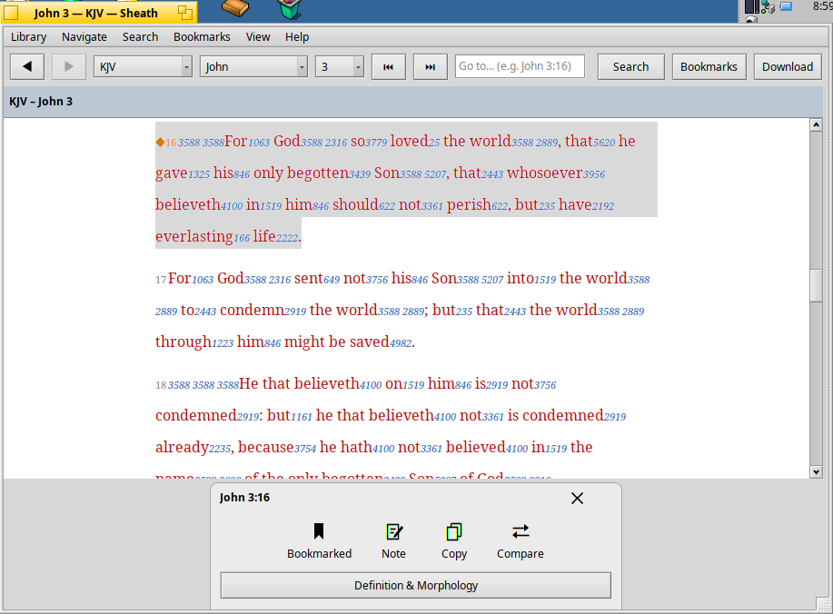
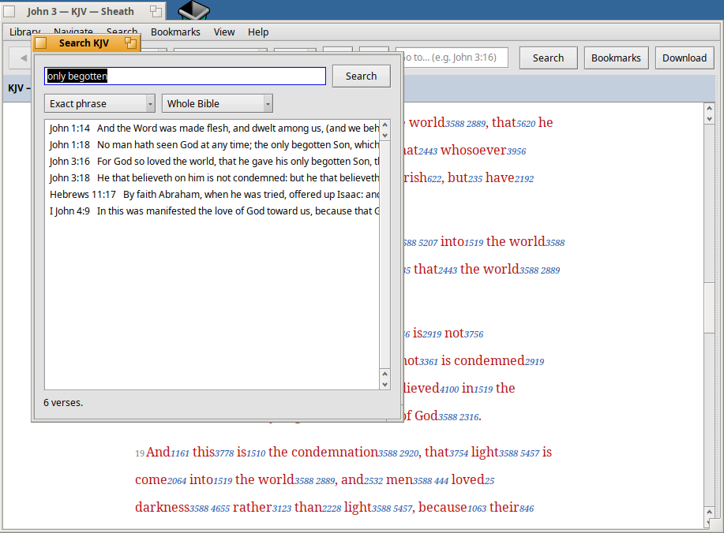
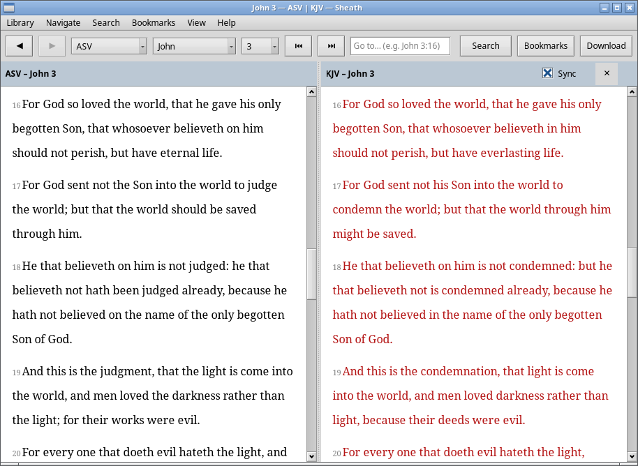

# Sheath

A Bible reader for [Renku OS](https://github.com/RenkuOS/Source), Haiku,
[VitruvianOS](https://v-os.dev) and Linux, built on the [SWORD](https://crosswire.org/sword/)
library. Loosely inspired by AndBible and [LinBible](https://github.com/idumych/linbible).

## Screenshots

*Haiku R1/beta6: John 3:16 in the KJV with Strong's numbers; clicking the verse opens its card.*

*VitruvianOS 0.6: searching the KJV for the exact phrase "only begotten" finds six verses.*

*Linux (X11; Wayland works too): the ASV and the KJV side by side, scrolled together.*

## Features

- A LinBible-style window: back and forward through where you've been, a Bible chooser, book
  and chapter, a Go to field ("jn 3:16", "Psalm 23"), and Search, Bookmarks and Download buttons
- Click a verse for its card: Bookmark, Note, Copy (with the reference), Compare (the verse in
  every installed Bible) and Definition & Morphology (each word's Strong's entry and parsing)
- Downloads Bibles, commentaries and dictionaries from CrossWire (Library ▸ Download modules…)
- Any SWORD Bible module, in its own versification
- Words of Christ in red, headings, footnotes
- Strong's numbers that open the Greek or Hebrew dictionary entry, and find every verse with it
- Search by words, exact phrase or regular expression, in the whole Bible, a testament or a book
- A second Bible side by side, scrolled together verse by verse
- Import MyBible modules (.SQLite3) as SWORD modules (Library ▸ Import MyBible module…)
- Noto Serif in a centred reading column; any installed font, line spacing, one verse per line
  or paragraphs

## Install

| Platform | Package | Install |
|---|---|---|
| Renku OS, Haiku R1/beta6 (x86_64) | `sheath-<version>-1-x86_64.hpkg` | `pkgman install ./sheath-*.hpkg` |
| VitruvianOS 0.6 (amd64, arm64) | `sheath_<version>-1_<arch>.deb` | `sudo apt install ./sheath_*_<arch>.deb` |
| Linux x86_64 (X11 or Wayland) | `Sheath-<version>-x86_64.AppImage` | `chmod +x Sheath-*.AppImage && ./Sheath-*.AppImage` |

Packages are on the [releases page](https://github.com/idumych/sheath/releases).

## Building

On Haiku or Renku:

    pkgman install sword_devel
    make            # ./Sheath
    make test       # core tests (downloads the KJV and StrongsGreek modules once)
    make hpkg       # sheath-<version>-<arch>.hpkg

CI builds every package: the `.hpkg` on Haiku R1/beta6 (`haiku.yml`), the VitruvianOS `.deb`s
natively on amd64 and arm64 Debian trixie (`deb.yml`), and the AppImage with Cosmoe on Ubuntu
24.04, smoke-tested under Wayland on a headless sway (`appimage.yml`).

## Licence

GPL-3.0. SWORD is GPL-2.0-or-later.
